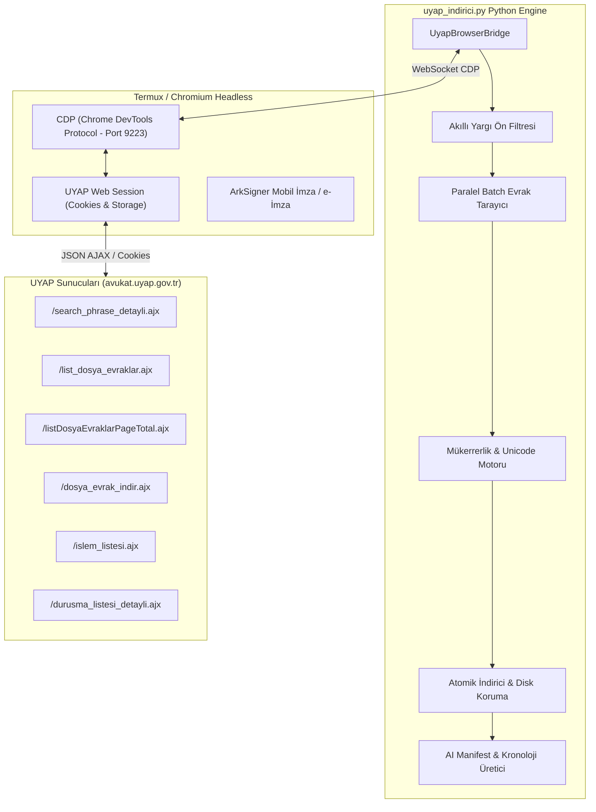
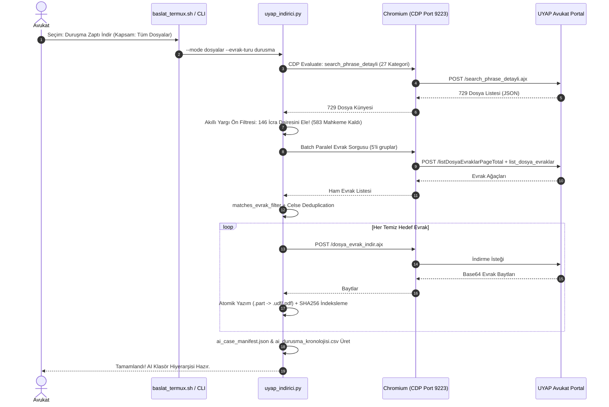

# 🏛️ UYAP Avukat Portal Evrak İndirici & AI Dava Analiz Altyapısı
## 📐 Kapsamlı Sistem Mimarisi, Gelişim Süreci ve Yapay Zeka Geliştirici Rehberi

> **Hedef Kitle:** Bu belge; bu repoyu devralacak, okuyacak, analiz edecek veya sistemi daha ileriye taşıyacak yapay zeka ajanları (LLM agents), otonom kodlayıcılar ve yazılım mühendisleri için hazırlanmıştır. Sistemin çıkış amacını, UYAP tersine mühendislik detaylarını, çözülen engelleri, mevcut mimariyi ve gelecekte yapılması gereken geliştirmeleri eksiksiz içerir.

---

## 📑 İçindekiler
1. [Projenin Amacı ve Vizyonu](#1-projenin-amacı-ve-vizyonu)
2. [UYAP Portal Altyapısı ve Tersine Mühendislik (Reverse Engineering)](#2-uyap-portal-altyapısı-ve-tersine-mühendislik)
3. [Kronolojik Gelişim ve Dönüm Noktaları (Changelog & Evolution)](#3-kronolojik-gelişim-ve-dönüm-noktaları)
4. [Sistem Mimarisi ve Veri Akışı](#4-sistem-mimarisi-ve-veri-akışı)
5. [Akıllı Filtreleme ve Hız Optimizasyonları](#5-akıllı-filtreleme-ve-hız-optimizasyonları)
6. [Yapay Zeka (AI / LLM) Uyumlu Veri Standartları ve Manifestolar](#6-yapay-zeka-uyumlu-veri-standartları)
7. [Mevcut Durum Analizi: Güçlü ve Geliştirilebilir Yönler](#7-mevcut-durum-analizi-güçlü-ve-geliştirilebilir-yönler)
8. [Gelecek Yapay Zeka Ajanları İçin Yol Haritası (Roadmap)](#8-gelecek-yapay-zeka-ajanları-için-yol-haritası)

---

## 1. Projenin Amacı ve Vizyonu

### 1.1. Pratik Hukuksal Problem
Türkiye'de avukatlar Adalet Bakanlığı **UYAP Avukat Portal** (`avukat.uyap.gov.tr`) sistemini kullanır. Bir avukatın portföyünde yüzlerce derdest (açık) ve arşivlenmiş (kapalı) dava dosyası bulunur. 
UYAP web arayüzünün temel kısıtları şunlardır:
1. **Toplu İndirme Yoktur:** Bir dava dosyasında 150 adet duruşma tutanağı veya rapor varsa, avukatın bunların her birine tek tek tıklayıp indirmesi gerekir.
2. **Ek Belgeler (Attachments) İşkencesi:** Mahkeme müzekkereleri ve kurum cevaplarının ekleri tek tek açılamaz; iç içe geçmiş klasörlerde kaybolur.
3. **Kısa Oturum Süresi:** UYAP oturumları 10-15 dakika işlem yapılmadığında düşer ve SMS/Mobil İmza onayı ister.
4. **Yapay Zeka Analizine Kapalılık:** Dosyalar derli toplu indirilemediği için bir LLM (Gemini, Claude, GPT-4) modeline "Bu dosyadaki tüm duruşma tutanaklarını kronolojik özetle, tanık ifadelerindeki çelişkileri bul ve son celsede verilen ara karara karşı beyan dilekçesi hazırla" demek imkansızdır.

### 1.2. Nihai Vizyon
Bu projenin nihai amacı; **avukatın tüm dava arşivini tek komutla, kategorize edilmiş, mükerrerlerden arındırılmış, kronolojik olarak indekslenmiş ve yapay zeka ajanlarının (RAG / Knowledge Graph / Otonom Savunma Ajanları) doğrudan işleyebileceği bir bilgi tabanına (Knowledge Base) dönüştürmektir.**

---

## 2. UYAP Portal Altyapısı ve Tersine Mühendislik

UYAP Avukat Portal, Angular/JSP altyapısıyla çalışan ve AJAX (`.ajx`) istekleri üzerinden JSON haberleşmesi yapan bir sistemdir.



### 2.1. Keşfedilen ve Tersine Mühendisliği Yapılan Endpoint'ler

| Endpoint | Metot | Görevi | Kritik Detaylar |
| :--- | :--- | :--- | :--- |
| `/search_phrase_detayli.ajx` | POST | Tüm dava dosyalarını sorgular | 27 yargı birimi ve Açık/Kapalı (`durum: 1/0`) parametreleri alır. Paralel `Promise.all` ile 729 dosya 2.88 saniyede çekilir. |
| `/listDosyaEvraklarPageTotal.ajx` | POST | Dosyadaki toplam evrak sayfa sayısını verir | `{dosyaId: "...", pageNumber: 1}` döner. Sayfa sayısı buradan hesaplanır. |
| `/list_dosya_evraklar.ajx` | POST | Sayfa bazlı dava evrak ağacını verir | Ana evrakları, celse açıklamalarını (`aciklama`), tarihleri ve `ekEvrakListesi` ağacını döner. |
| `/dosya_evrak_indir.ajx` | POST | Dava evrakı veya ekini Base64 olarak indirir | `{dosyaId: "...", evrakId: "..."}` parametresiyle çağrılır. Dönen Base64 decode edilerek `.udf`, `.pdf`, `.tif` olarak diske yazılır. |
| `/islem_listesi.ajx` | POST | Avukatın portaldan yaptığı işlemleri listeler | Tarih aralığı (`start_date`, `end_date`) alır. UYAP tek sorguda max 500 kayıt verdiği için 30 günlük dilimlere bölünür. |
| `/islem_evrak_indir.ajx` | POST | İşlem portali evrakını indirir | `{evrakId: "...", gelenGidenEvrakId: "..."}` alır. |
| `/durusma_listesi_detayli.ajx` | POST | Gelecek ve geçmiş duruşmaları döner | Avukatın duruşma takvimini listeler. |

### 2.2. Dinamik Session Token Mekanizması (`dosyaId` Şifrelemesi)
UYAP güvenlik amacıyla `dosyaId` değerini **oturum bazlı dinamik şifreler** (AES token). 
- Dün alınan bir `dosyaId` ("vkjPwg..."), bugün oturum yenilendiğinde UYAP sunucusunda geçersiz kalır (`errorCode: PRTL_GNL_10001-4 Doğrulama hatası`).
- **Çözüm:** `tum_dosyalar_cache.json` önbellek süresi 30 dakika ile sınırlandırılmıştır ve gerektiğinde anında `use_cache=False` ile 2.8 saniyede taze oturum token'larıyla yenilenir.

---

## 3. Kronolojik Gelişim ve Dönüm Noktaları

### 1. Aşama: İşlemlerim (Son 1 Yıl) REST Tersine Mühendisliği
- Avukat Portal'daki "İşlemlerim" sekmesi analiz edildi.
- `UYAP` web oturumu açıkken CDP portu (9223) üzerinden oturum çerezleri paylaşıldı.
- UYAP'ın 500 kayıtlık kısıtlaması, tarih aralığını 30 günlük dilimlere bölen (`chunk-days=30`) sorgulama motoruyla aşıldı.

### 2. Aşama: Termux Android Desteği & ArkSigner Mobil İmza Entegrasyonu
- Android telefonlarda Termux terminali üzerinde `chromium` headless veya `Termux:X11` grafik ekranıyla çalışma desteği sağlandı.
- Oturum 15 dakikada bir düştüğünde, script'in çökmesini engelleyen `login_with_mobil_imza()` mekanizması kuruldu. Türk Telekom / Turkcell / Vodafone Mobil İmza API akışı otomatik tetiklenerek telefona onay bildirimi gönderildi.

### 3. Aşama: Açık ve Kapalı (Karara Çıkmış) 729 Dosyanın Taranması
- Başlangıçta UYAP sadece "Sık Kullanılan 32 Dosya"yı listeliyordu.
- UYAP Mahkeme Kodları haritası çıkarıldı (Ceza, Hukuk, İcra Mahkemesi, İdari Yargı olmak üzere 27 farklı yargı birimi).
- `/search_phrase_detayli.ajx` servisi 27 kategori için paralel `Promise.all` ile sorgulanarak **729 dosyanın tamamı 2.88 saniyede** taranabilir hale getirildi.

### 4. Aşama: Dava Evrakları ve Ek Belgelerin İndirilmesi
- Dava dosyalarının içindeki tüm evrak sayfaları (`list_dosya_evraklar.ajx`) taranarak evraklar ve `ekEvrakListesi` hiyerarşisi çözüldü.
- Atomik dosya yazımı (`.part` geçici dosyası ve sağlamlık kontrolü) getirilerek yarım inen bozuk dosyalar engellendi.

### 5. Aşama: Duruşma Takvimi Oluşturucu (.ics / Google Takvim)
- Duruşma listesi çekilerek avukatın telefonundaki Google Takvim veya Apple Takvim'e tek tıkla aktarabileceği `.ics` iCalendar dosyası ve Excel CSV tablosu üretildi.

### 6. Aşama: Hatalı Evrak Eşleşmesi ve Mükerrerlik Sorununun Çözümü
- **Problem:** Duruşma arandığında 11 duruşması olan dosyada 59 duruşma, Kırıkkale 2. ACM'de ise 1.937 duruşma bulunuyordu.
- **Kök Neden:** `"zapt"` ve `"tutanak"` araması `Tensip Zaptı`, `Savcılık Zaptolunan Eşya Makbuzu` ve `Bilirkişi Teslim Tutanağı` evraklarını duruşma zaptı sayıyordu. Ayrıca mahkemelerin müzekkere ekinde gönderdiği kopya duruşma tutanakları da mükerrer toplanıyordu.
- **Çözüm:** Kesin negatif dışlama motoru (`matches_evrak_filter`), Türkçe Unicode normalize edici (`tr_lower`) ve `(Mahkeme, EsasNo, CelseTarihi)` mükerrerlik eleme motoru yazıldı. Erzurum 1. ACM'de tam olarak 11 gerçek duruşma zaptı bulundu.

### 7. Aşama: Akıllı Yargı Ön Filtresi, Paralel Batch Tarayıcı ve AI Manifestosu
- **Problem:** İcra Dairelerinde (150+ dosya) duruşma aranması saatler kaybettiriyordu.
- **Çözüm:** İcra daireleri ve CBS soruşturma dosyaları duruşma aramasından otomatik elendi (`is_case_relevant_for_filter`).
- Tarayıcı içinde 5'li paralel evrak sorgulama (`query_dosyalar_evraklar_batch`) geliştirildi.
- İndirilen evraklar `Ceza_Yargisi`, `Hukuk_Yargisi`, `Idari_Yargi` şeklinde kategorize edilerek yanına `ai_case_manifest.json` ve `ai_durusma_kronolojisi.csv` üretildi.

### 8. Aşama: Oturum Düşmesi & "Fiziksel Dosya Yok" Yanılsamasının Düzeltilmesi (Session Expiry vs Missing File Fix)
- **Problem:** İndirme işlemi 150. evraka geldiğinde (~15 dakika sonra) UYAP oturumu zaman aşımına uğruyor, sunucu `/giris` HTML sayfasına yönlendiriyordu. Ancak `/avukatKisiselBilgileriSorgula.ajx` servisi arka planda kullanıcı bilgisini dönmeye devam ettiği için script oturumu açık sanıyor ve kalan 2.121 evrakı *"UYAP sunucusunda fiziksel dosya yok"* diyerek hatalı biçimde atlıyordu.
- **Çözüm:** 
  1. Kesin oturum doğrulayıcı (`is_logged_in`) geliştirildi. Sayfa URL'i `/giris` ise veya korumalı API `PRTL_GNL_10000-2` dönüyorsa oturumun kesin kapalı olduğu tespit edilir.
  2. Dönen yanıtın `text/html` olması oturum düşmesi olarak işaretlendi ve otomatik Mobil İmza tetiklendi.
  3. `login_with_mobil_imza` fonksiyonunun sahte "Zaten açık oturum var" diyerek döngüye girmesi engellendi.
  4. Oturum yenilendikten sonra UYAP'ın sıfırladığı dinamik AES `dosyaId` token'larını kuyruktaki tüm kalan evraklar için anında yenileyen `refresh_dosya_ids_in_queue` mekanizması devreye alındı.

---

## 4. Sistem Mimarisi ve Veri Akışı



---

## 5. Akıllı Filtreleme ve Hız Optimizasyonları

### 5.1. Yargı Birimi Mantıksal Eşleştirme Tablosu

| Evrak Filtresi (`--evrak-turu`) | Taranan Birimler | Kesinlikle Atlanan Birimler (Hız Kazancı) |
| :--- | :--- | :--- |
| `durusma` | Ceza Mahkemeleri, Hukuk Mahkemeleri, İcra Hukuk/Ceza Mahkemeleri, İdari Yargı | **İcra Daireleri, İcra Müdürlükleri, Arabuluculuk, CBS Soruşturma, Tevzi/Ön Büro** |
| `iddianame` | Ağır Ceza, Asliye Ceza, Çocuk Mah., CBS Soruşturma | **Tüm Hukuk Mahkemeleri, İcra Daireleri, İdare Mahkemeleri** |
| `tensip` | Ceza, Hukuk, İcra Mahkemesi, İdare Mahkemesi | **İcra Daireleri, CBS Soruşturma, Arabuluculuk** |
| `bilirkisi` | Ceza, Hukuk, İcra Mahkemesi, İdari Yargı, CBS | **İcra Daireleri, Arabuluculuk** |
| `karar` | Tüm Mahkemeler, BAM İstinaf, Yargıtay, Danıştay | **İcra Daireleri, Arabuluculuk** |
| `tumu` | İstisnasız tüm dosyalar (Açık + Kapalı) | Hiçbiri (Tam arşiv) |

### 5.2. Hedefli Mahkeme / Dosya Araması (`--filter-birim`)
Avukat yalnızca tek bir dosyanın duruşmalarını almak istiyorsa:
```bash
python3 uyap_indirici.py --cli --mode dosyalar --evrak-turu durusma --filter-birim "erzurum 1. ağır"
python3 uyap_indirici.py --cli --mode dosyalar --evrak-turu durusma --filter-birim "2025/506"
```
Bu komut 729 dosyayı taramak yerine **yalnızca ilgili dosyayı 2 saniyede** tarayıp indirir.

---

## 6. Yapay Zeka Uyumlu Veri Standartları

İndirilen dosyalar, bir yapay zekanın dosya yapısını doğrudan anlayabileceği standart bir hiyerarşide depolanır:

### 6.1. Klasörleme Mimarisi
```
DURUSMA_TUTANAKLARI /
├── ai_case_manifest.json          <-- Ana AI Dava Kütüphanesi
├── ai_durusma_kronolojisi.csv     <-- Tablosal Duruşma Takvimi
├── indeks.csv                     <-- Teknik İndirme Kayıtları
│
├── Ceza_Yargisi /
│   └── Erzurum_1._Agir_Ceza_Mahkemesi /
│       └── 2025_506 /
│           └── DURUSMA_TUTANAKLARI /
│               ├── 2025-12-17_Durusma_Zapti_1._Celse_12372.udf
│               ├── 2026-02-06_Durusma_Zapti_2._Celse_15640.udf
│               ├── 2026-03-27_Durusma_Zapti_3._Celse_18920.udf
│               └── 2026-06-12_Durusma_Zapti_6._Celse_24510.udf
│
└── Hukuk_Yargisi /
    └── Oltu_3._Asliye_Hukuk_Mahkemesi /
        └── 2026_6 /
            └── GEREKCELI_KARARLAR /
                └── 2026-10-14_Gerekceli_Karar_3823.udf
```

### 6.2. `ai_case_manifest.json` Veri Şeması
```json
{
  "manifest_surumu": "2.0-ai-ready",
  "olusturma_tarihi": "2026-11-14T00:15:07",
  "toplam_hedef_dosya": 1,
  "toplam_hedef_evrak": 11,
  "dosyalar": [
    {
      "birim_adi": "Erzurum 1. Ağır Ceza Mahkemesi",
      "dosya_no": "2025/506",
      "dosya_id": "...",
      "yargi_turu": "Ceza_Yargisi",
      "dosya_turu": "Agir_Ceza_Mahkemesi",
      "durusma_tarihleri": [
        "2025-12-17",
        "2026-02-06",
        "2026-03-27",
        "2026-05-15",
        "2026-06-09",
        "2026-06-12"
      ],
      "evraklar": [
        {
          "evrak_id": "...",
          "tarih": "2026-06-12",
          "evrak_adi": "Duruşma_Zaptı_6._Celse",
          "evrak_turu": "Duruşma Zaptı",
          "is_attachment": false,
          "unique_key": "dosya_..."
        }
      ]
    }
  ]
}
```

---

## 7. Mevcut Durum Analizi: Güçlü ve Geliştirilebilir Yönler

### 🟢 Güçlü Yönler (Strengths)
1. **Sıfır İnsan Müdahalesi ile Giriş:** ArkSigner Mobil İmza entegrasyonu sayesinde oturum düştüğünde avukat yalnızca telefonuna gelen onay kodunu onaylar; parola girmekle uğraşmaz.
2. **Yüksek Hız:** 729 dosya 2.88 saniyede listelenir; gereksiz İcra Daireleri anında elenir; 5'li paralel batch sorgusu ile evrak ağacı dakikalar içinde taranır.
3. **Mükerrersiz Temiz Veri:** Mahkemeler arası talimat evrakları veya mükerrer duruşma suretleri deduplication motoru sayesinde elenir.
4. **Termux / Android Uyumu:** Hiçbir harici sunucuya veya buluta ihtiyaç duymadan, avukatın doğrudan cebindeki Android telefonda çalışır; gizlilik ve KVKK riskleri sıfırdır.
5. **AI Entegrasyonuna Hazır:** Dava künyesi, celse numaraları, duruşma tarihleri ve kronoloji tabloları JSON/CSV formatında anında hazırdır.

### 🔴 Kısıtlar ve Geliştirilebilir Yönler (Limitations)
1. **UDF Formatı Engeli:**
   - İndirilen birçok mahkeme kararı ve duruşma zaptı `.udf` (UYAP Doküman Formatı) uzantılıdır.
   - UDF, Adalet Bakanlığı'nın tescilli bir ZIP/XML paketidir (içinde `content.xml` yer alır).
   - Yapay zekanın bu dosyayı doğrudan okuyabilmesi için düz metne (`.txt` veya `.md`) dönüştürülmesi gerekir.
2. **Taranmış TIF / PDF Resimleri (OCR İhtiyacı):**
   - Bazı mahkemeler evrakları taranmış `.tif` veya `.pdf` görseli olarak yükler. Bunların içinde aranabilir metin bulunmaz; OCR pipeline'ı gereklidir.
3. **UYAP WAF / Bot Koruma Limitleri:**
   - UYAP sunucuları arka arkaya saniyede 10'dan fazla indirme yapıldığında IP engeli (rate limit) koyabilir. Script bu yüzden güvenli bekleme aralıkları (`min_d=1.2s`, `max_d=2.8s`, her 20 dosyada 10s mola) ile çalışır. Bu süreler güvenlidir ancak arşiv çok büyük olduğunda indirme işlemi zaman alır.

---

## 8. Gelecek Yapay Zeka Ajanları İçin Yol Haritası

Bu repoyu geliştirecek sonraki yapay zeka ajanının yapması gereken öncelikli görevler:

### 🚀 Görev 1: Yerel UDF -> Markdown / TXT Çevirici Motoru Ekleme
UDF dosyaları özünde bir ZIP arşividir. İçinde `content.xml` bulunur.
```python
import zipfile, xml.etree.ElementTree as ET

def udf_to_text(udf_path):
    with zipfile.ZipFile(udf_path, 'r') as z:
        xml_content = z.read('content.xml')
        root = ET.fromstring(xml_content)
        # XML düğümlerindeki tüm metinleri topla
        text = "".join(root.itertext())
        return text
```
Bu fonksiyon `uyap_indirici.py` içine entegre edilerek, indirilen her `.udf` dosyasının yanına anında `<dosya>.txt` veya `<dosya>.md` kopyası yazılmalıdır. Böylece LLM'ler hiçbir ek araca ihtiyaç duymadan dosyayı okuyabilir.

### 🚀 Görev 2: Tesseract / Vision AI OCR Entegrasyonu
Termux üzerinde `pkg install tesseract` kurularak taranmış `.tif` ve `.pdf` evrakları otomatik OCR'dan geçirilmeli ve metin katmanı çıkarılmalıdır.

### 🚀 Görev 3: Yerel RAG / Vektör Veri Tabanı (Chroma / SQLite-VSS)
Tüm indirilen ve metne dönüştürülen dava evrakları, yerel bir vektör veri tabanına gömülmelidir (embeddings).
Avukat terminalden veya sohbet arayüzünden:
> *"2025 yılında açılan ceza dosyalarımda aleyhe verilen adli kontrol kararlarını listele ve itiraz sürelerini hesapla"*
dediğinde otonom ajan anında cevap üretebilmelidir.

### 🚀 Görev 4: Otonom Hukuki Savunma ve Mazeret Dilekçesi Ajanı
- Duruşma zaptındaki son ara kararı analiz edip bilirkişi raporuna itiraz dilekçesi taslağı hazırlayan;
- Çakışan duruşma günleri için ilgili mahkemelere otomatik mazeret dilekçesi üreten bir üst akıl katmanı inşa edilmelidir.

---
*Hazırlayan: Google DeepMind - Antigravity AI*  
*Son Güncelleme: 14 Kasım 2026*
